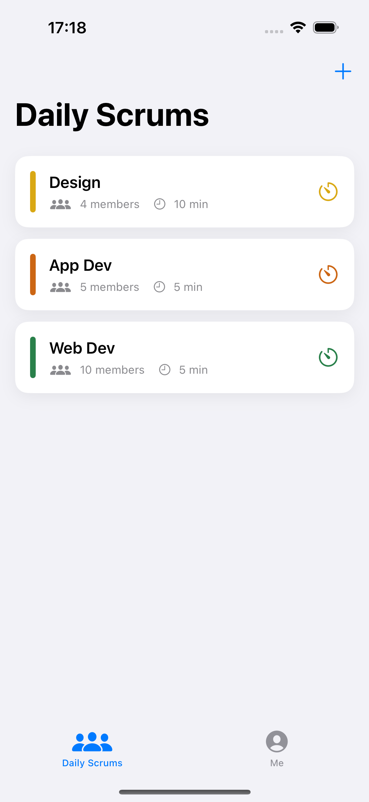
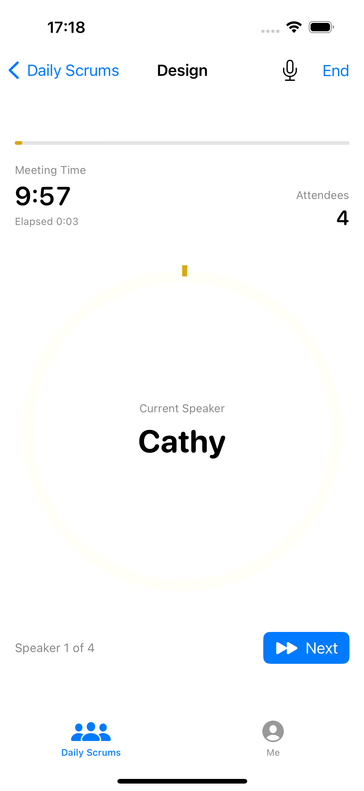
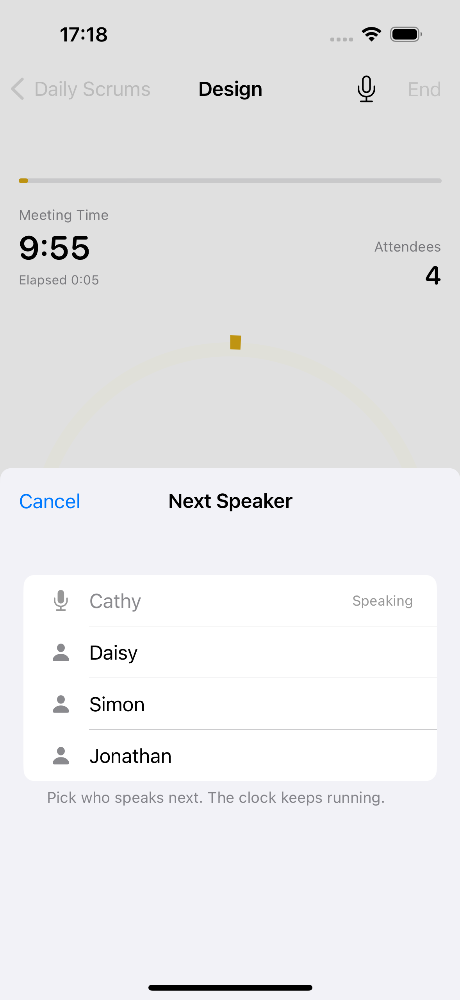
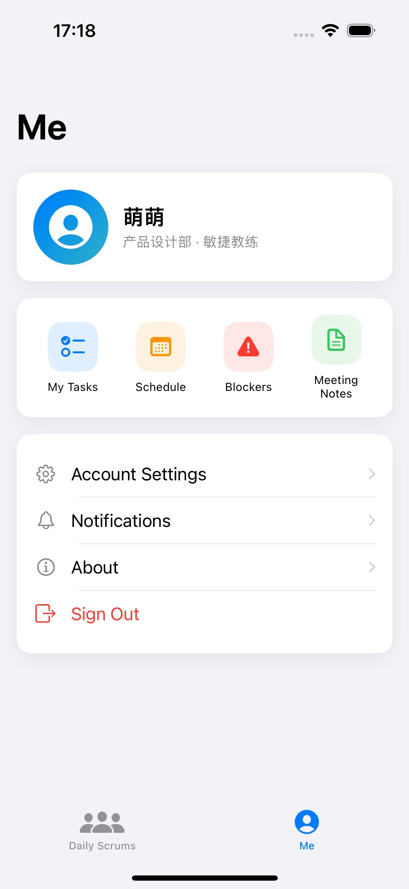
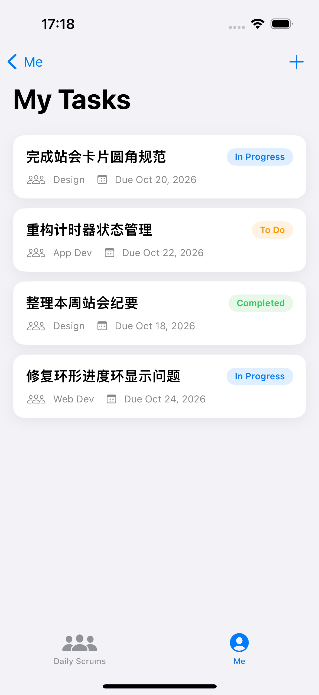
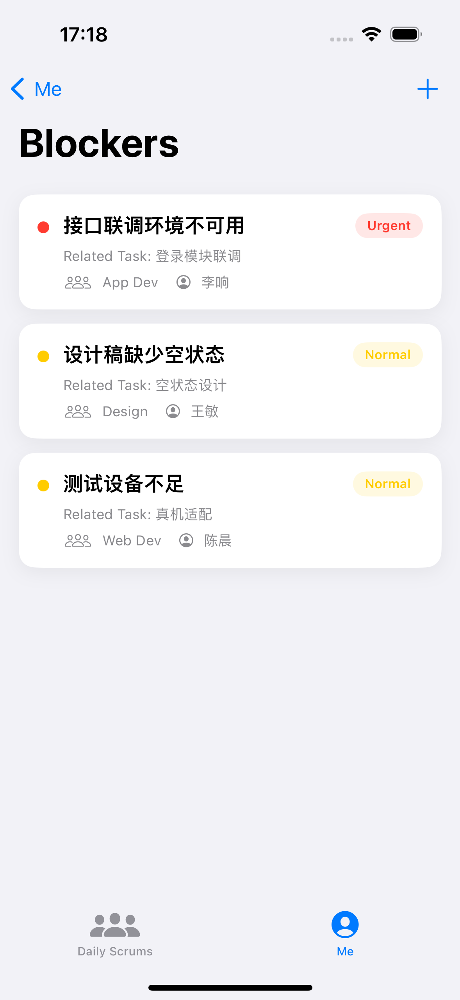
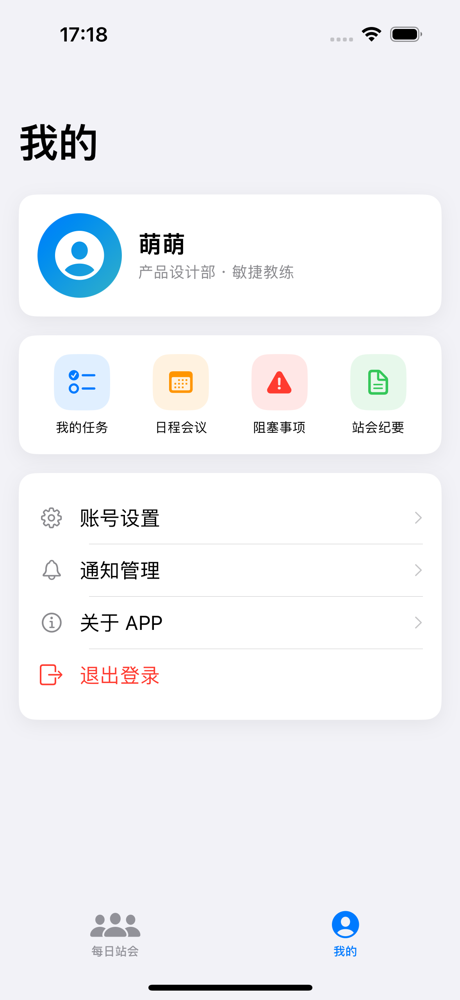
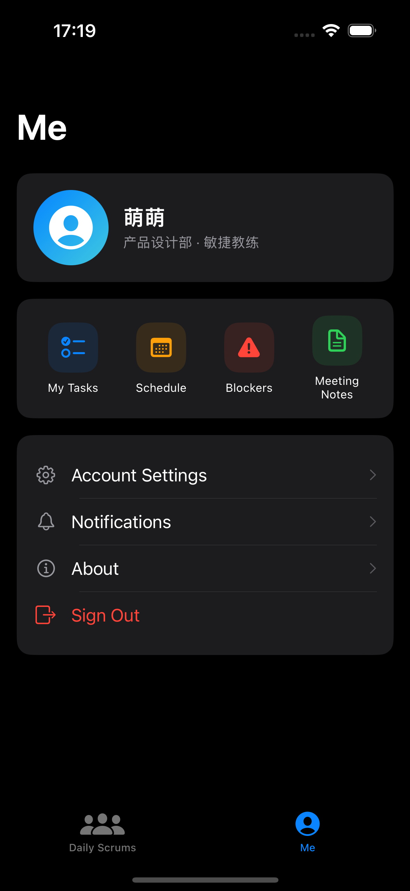

# Scrumdinger

敏捷团队的每日站会 App：用计时器把站会控制在既定时间内，并管理任务、日程、阻塞事项与站会纪要。

SwiftUI + MVVM，`ObservableObject` 管理状态，iOS 16+，无任何第三方依赖。

## 功能

### 每日站会 Tab

| 功能 | 说明 |
|---|---|
| 小组卡片 | 展示小组名称、成员数量、站会时长，圆角 14 + 柔和阴影 |
| 新建小组 | 右上角 ＋，模态表单编辑名称、成员、时长与主题色 |
| 开始计时 | 点击卡片直接进入会议计时；长按卡片可查看详情与历史 |
| 会议计时 | 顶部进度条 + 剩余时间 + 当前发言人；自动切人时播放「叮」声 |
| 指定发言人 | 点「下一位」弹出面板，可指定任意还没发言的人，计时不中断 |
| 环形进度环 | 按发言人时段绘制，总时长走完时刚好填满 |
| 录音与纪要 | 会议中可录音，结束后自动写入历史记录并可回放 |

### 我的 Tab

| 功能 | 说明 |
|---|---|
| 个人信息 | 头像、用户名、部门与角色 |
| 快捷入口 | 我的任务、日程会议、阻塞事项、站会纪要，`NavigationLink` 推入独立页面 |
| 设置列表 | 账号设置、通知管理、关于 APP、退出登录 |

四个子页面：

- **我的任务**：任务卡片（标题、所属小组、状态标签、截止日期），右上角新建任务；
- **日程会议**：今日会议卡片（时间、会议名称、小组、加入按钮）；
- **阻塞事项**：卡点卡片，紧急红点 / 普通黄点，展示关联任务、小组、负责人，支持新建；
- **站会纪要**：历史站会卡片（小组、日期、摘要）。

### 其他

- 中英双语（String Catalog），深色模式自适应；
- 站会数据持久化到 JSON；任务 / 阻塞 / 纪要等演示数据由 ViewModel 管理；
- 卡片统一圆角 14、柔和阴影、SF Symbols 图标。

## 环境要求

- macOS + Xcode 15.1 及以上
- iOS 16.0 及以上（已在 iOS 17.2 模拟器验证）
- 无需 CocoaPods / Swift Package

工程：`Scrumdinger.xcodeproj`，共享 Scheme `Scrumdinger`，Bundle ID `com.student.scrumdinger`。

## 运行

```bash
xcodebuild -project Scrumdinger.xcodeproj \
           -scheme Scrumdinger \
           -destination 'platform=iOS Simulator,name=iPhone 15' \
           build
```

也可以直接双击 `Scrumdinger.xcodeproj`，选 iPhone 15 模拟器后 ⌘R。

## 使用步骤

1. 启动后进入「每日站会」，点击任意小组卡片即可开始计时；
2. 计时页点击「下一位」，在弹出的面板里选择下一位发言人（已发言的人不可选）；
3. 需要记录讨论时点右上角麦克风按钮录音，点「End」结束会议，记录会自动写入历史；
4. 底部切到「我的」，点四个快捷入口进入任务、日程、阻塞、纪要页面；
5. 任务页与阻塞页右上角 ＋ 可以新建条目；日程页点「加入」标记已加入。

## 目录结构

```
Scrumdinger/
├── ScrumdingerApp.swift          # @main，进入 RootTabView
├── Models/
│   ├── DailyScrum / Theme / History
│   ├── ScrumTimer.swift          # 计时核心：连续时钟 + 发言人时段
│   ├── ScrumStore.swift          # JSON 持久化 + 错误兜底
│   ├── AudioRecorder / DingPlayer / RecordingStorage
│   ├── AttendeeService.swift     # 网络获取参会者
│   └── UserProfile / WorkItems   # 任务、会议、阻塞、纪要模型
├── ViewModels/
│   ├── TaskListViewModel
│   ├── ScheduleViewModel
│   ├── BlockerListViewModel
│   ├── RetroListViewModel
│   └── ProfileViewModel
├── Views/
│   ├── RootTabView / ScrumsView / CardView
│   ├── MeetingView / MeetingTimerView / SpeakerArc / SpeakerPickerView
│   ├── ProfileView / MyTasksView / ScheduleView / BlockersView / MeetingNotesView
│   ├── NewTaskSheet / NewBlockerSheet / SettingsViews
│   ├── DetailView / DetailEditView / HistoryView / ThemePicker
│   └── CardStyle.swift           # 圆角 14 卡片、状态标签、空状态
└── Resources/
    ├── Localizable.xcstrings     # 中英双语
    ├── InfoPlist.xcstrings       # 麦克风权限说明本地化
    └── ding.wav
ScrumdingerTests/                 # 22 个 XCTest 单元测试
ScrumdingerUITests/               # 4 个 UI 测试（含截图用例）
screenshots/                      # 模拟器运行截图
```

## 本地化

界面文案由 `Localizable.xcstrings` 管理，默认跟随系统语言，提供 English 与简体中文。主题名称（Indigo、Teal 等）保持英文原名。

强制某种语言启动（调试用）：

```bash
xcrun simctl launch booted com.student.scrumdinger -AppleLanguages "(zh-Hans)"
```

## 数据存放

- 站会数据：`Application Support/Scrumdinger/scrums.json`（原子写入）
- 录音文件：`Application Support/Scrumdinger/Recordings/*.m4a`

首次启动写入三条示例站会；读取失败会回退示例数据并弹出错误提示。

## 已知限制

- 只在 iPhone 上验证，未做 iPad 与 macOS 适配；
- 任务、日程、阻塞、纪要使用内存示例数据，重启后恢复默认（站会数据已持久化）；
- 模拟器录音依赖 Mac 麦克风，音质与真机有差异；
- 会议录音只保留本次会议最近一次开始的文件；
- App 图标仍为占位资源。

## 截图

| 每日站会 | 会议计时 |
|---|---|
|  |  |

| 选择下一位 | 我的 |
|---|---|
|  |  |

| 我的任务 | 阻塞事项 |
|---|---|
|  |  |

| 中文界面 | 深色模式 |
|---|---|
|  |  |

## 测试

```bash
xcodebuild -project Scrumdinger.xcodeproj -scheme Scrumdinger \
  -destination 'platform=iOS Simulator,name=iPhone 15' test
```

- 单元测试 22 个：计时器（时段分配、指定发言人、叮声回调、结束边界）、模型 Codable、JSON 存储、网络解码；
- UI 测试 4 个：新建站会并重启验证持久化、全流程截图、中文界面、深色模式。

完整结果见 `test-results.txt`。

## 提交记录

| 提交 | 内容 |
|---|---|
| `feat(S1)` | 声明式视图搭建计时器界面骨架 |
| `feat(S2)` | 列表、详情、编辑、新建的导航与模态 |
| `feat(S3-S5)` | 计时状态、JSON 持久化、环形进度环与录音 |
| `test(S6)` | 单元测试与 UI 走查截图用例 |
| `feat(S7)` | 中英双语、网络参会者、设计打磨 |
| `docs(S8)` | README、实训报告与截图 |
| `feat(UI)` | TabView、个人中心与四个子页面（MVVM） |
