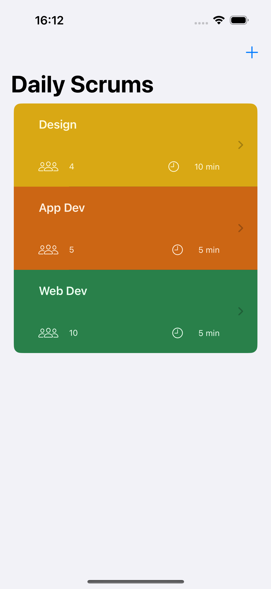
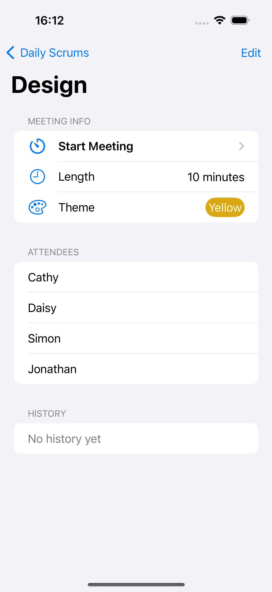
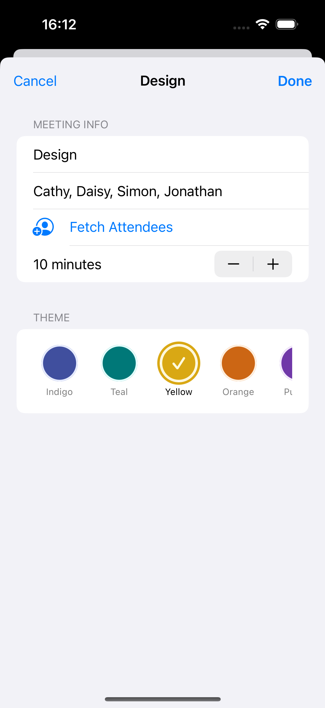
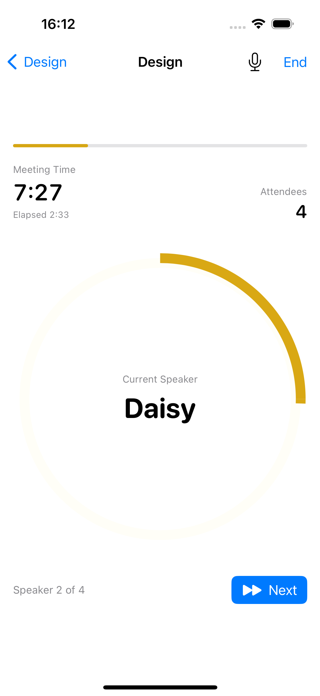
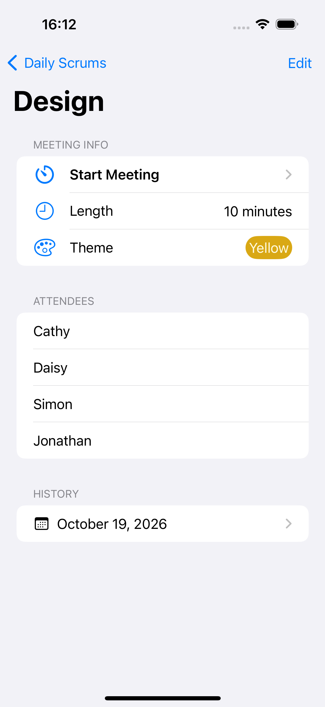
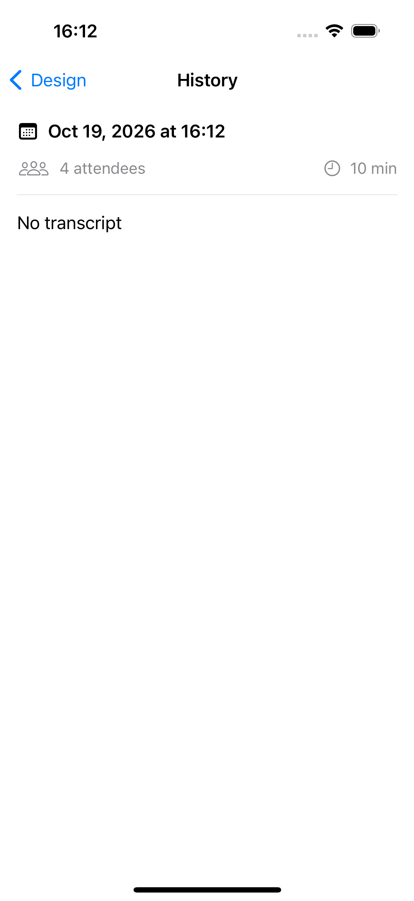
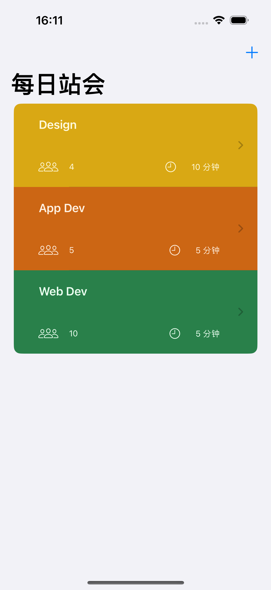
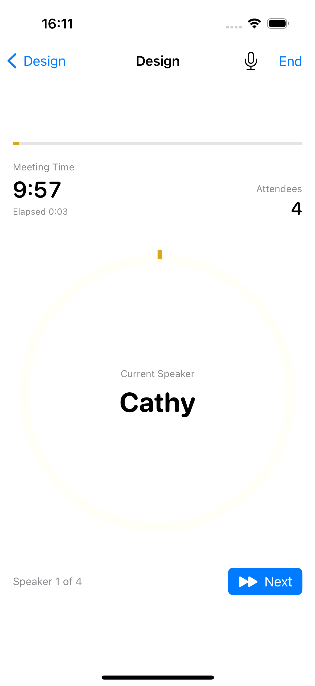

# Scrumdinger 项目实训报告

## 1. 项目基本信息

- 项目名称：Scrumdinger 每日站会管理 App
- 开发者 / 学号：__________
- 完成日期：2026-10-19
- 开发环境：Xcode 15.1（15C65） / iOS 17.2 SDK / iPhone 15 模拟器（iOS 17.2）
- 工程：`Scrumdinger.xcodeproj`，Bundle ID `com.student.scrumdinger`，无第三方依赖

## 2. 项目简介

### 应用定位与核心问题

Scrumdinger 面向需要主持每日站会（Daily Scrum）的软件团队。站会本身只有 15 分钟，但经常因为个别人发言过长而失控。Scrumdinger 给每位参会者分配固定发言时长，用进度条、环形进度环和提示音把时间可视化，主持人不必频繁看表、也不必打断别人。

### 目标用户与使用场景

- 迭代中的开发团队：每天固定时间开站会，需要一个轻量的计时工具；
- 实训 / 课堂演示：需要直观展示「声明式 UI + 数据驱动」的完整 App。

### 主要功能

1. 站会列表：卡片展示名称、参会人数、时长与主题色；
2. 新建 / 编辑：标题、参会者、时长、7 套配色主题；
3. 详情页：会议信息、参会者名单、历史记录入口；
4. 会议计时：剩余时间、进度条、当前发言人、下一位；
5. 环形进度环：一人一段圆弧，走满自动切人并播放「叮」声，环满结束；
6. 历史记录：会议结束自动生成，可查看并回放录音；
7. 会议录音：AVFoundation 录制，保存在沙盒；
8. 网络示例：编辑页从公开接口拉取参会者名单；
9. 中英双语与深色模式。

## 3. 技术方案与架构

### 视图层级与导航

```
ScrumsView（NavigationStack + List）
├── NewScrumSheet（sheet）→ DetailEditView
└── DetailView（NavigationLink）
    ├── DetailEditView（sheet，含 ThemePicker）
    ├── MeetingView（NavigationLink）
    │   ├── MeetingHeaderView
    │   ├── MeetingTimerView → SpeakerArc × N
    │   └── MeetingFooterView
    └── HistoryView（NavigationLink）
```

### 数据模型

| 模型 | 字段 | 说明 |
|---|---|---|
| `DailyScrum` | `id: UUID`、`title`、`attendees: [String]`、`lengthInMinutes`、`theme`、`history: [History]` | 站会定义，`Codable` + `Identifiable` |
| `Theme` | `id`、`name`、`mainColor: ColorValue`、`accentColor: ColorValue` | 7 套预置主题；`ColorValue` 存 RGB，解决 `Color` 不可 Codable 的问题 |
| `History` | `id`、`date`、`attendees`、`lengthInMinutes`、`transcript`、`recordingFileName` | 会议结束追加；录音文件名为可选，兼容旧数据 |
| `ScrumTimer` | `secondsElapsed`、`activeSpeakerIndex`、`isFinished`、`lengthInMinutes`、`attendees` | `ObservableObject`，`tick()` 可独立驱动 |

### 状态管理与数据流

- `ScrumsView` 持有 `@StateObject ScrumStore`，`List($store.scrums)` 用绑定把修改写回数组；
- 子页面用 `@Binding var scrum` 接收单个站会，编辑页内部用 `@State draft` 做草稿，点「完成」才回写，取消不影响原数据；
- 会议页用 `@StateObject ScrumTimer`，`@Published` 的 `secondsElapsed` / `activeSpeakerIndex` 驱动头部、环形环与底部按钮刷新，没有任何手动刷新代码；
- `ScrumStore` 监听数组变化，400 ms 合并后写 JSON，读写失败转成 `ErrorWrapper` 由 `ErrorView` 呈现。

## 4. 各模块实现说明

> 实训单 4.7–4.8 节提到的 UIKit 集合视图、可编辑视图、增删筛选提醒来自 Apple 另一套课程中的 Today App，与 Scrumdinger 功能无关，且评分表未包含该项，因此本项目按评分表聚焦 Scrumdinger 主线，用 SwiftUI 完成等价交互。

### 4.1 SwiftUI 声明式 UI

整个 App 由结构体视图组合而成，没有 `UIViewController`。列表用 `List($scrums)` 直接生成绑定，导航用 `NavigationStack` + `NavigationLink`，模态用 `.sheet`。主题色、字号、间距全部通过修饰符声明，深色模式与 Dynamic Type 自动适配。

示例（会议页）：

```swift
MeetingTimerView(attendees: scrum.attendees,
                 speakerIndex: timer.activeSpeakerIndex,
                 secondsElapsed: timer.secondsElapsed,
                 secondsPerAttendee: timer.secondsPerAttendee,
                 mainColor: scrum.theme.main,
                 accentColor: scrum.theme.accent)
```

### 4.2 绘图：环形进度环

`SpeakerArc` 是一个 `Shape`，把 360° 按参会人数均分，第 `i` 段从 `i × 360/n - 90°` 开始（`-90°` 让第一段从 12 点方向起笔），当前发言人再按已用时间比例截断：

```swift
let degreesPerSpeaker = 360.0 / Double(totalSpeakers)
let startDegrees = Double(speakerIndex) * degreesPerSpeaker - 90
let endDegrees = startDegrees + degreesPerSpeaker * min(max(fraction, 0), 1)
path.addArc(center: center, radius: radius,
            startAngle: .degrees(startDegrees),
            endAngle: .degrees(endDegrees),
            clockwise: false)
```

`MeetingTimerView` 为每位参会者叠一个 `SpeakerArc`，用 `StrokeStyle(lineWidth: 12, lineCap: .butt)` 保证段与段之间不粘连；已讲完的人 `fraction = 1`，当前人按比例，未讲的人不画。计时器每前进 1 秒，`fraction` 随之增长，所以环形环与顶部进度条始终一致。

### 4.3 音频：提示音与录音

- 提示音：`DingPlayer` 用 `AVAudioPlayer` 播放随包的 `ding.wav`（自制正弦衰减音，无版权问题），资源缺失时降级到 `AudioServicesPlaySystemSound`；
- 录音：`AudioRecorder` 用 `AVAudioSession` 的 `.playAndRecord` 类别（带 `.defaultToSpeaker`，否则提示音会走听筒），`AVAudioRecorder` 输出 44.1 kHz / 单声道 AAC（`.m4a`），文件写入 `Application Support/Scrumdinger/Recordings/`；
- 权限：iOS 17 的 `AVAudioApplication.requestRecordPermission` 异步申请，拒绝时弹提示；`Info.plist` 的麦克风说明通过 `InfoPlist.xcstrings` 做了中英双语；
- 会议结束时把文件名写进 `History.recordingFileName`，`HistoryView` 用 `AVAudioPlayer` 回放。

### 4.4 持久化与错误处理

- 数据文件：`Application Support/Scrumdinger/scrums.json`，`JSONEncoder` 的 `iso8601` 日期策略 + `prettyPrinted`，便于人工检查；
- 写入策略：数组变化后 400 ms 防抖合并，`data.write(to:options:.atomic)` 原子写，避免写到一半损坏文件；
- 错误兜底：读取失败 → 保留原文件、回退示例数据并弹出 `ErrorView`（`ErrorWrapper` 包装错误与操作建议）；写入失败 → 同样提示，且不覆盖内存中的数据；
- 兼容性：`History.recordingFileName` 是可选字段，旧 JSON 没有该键也能解码（单元测试覆盖）。

### 4.5 网络数据与测试

- `AttendeeService` 用 `URLSession` + `async/await` 请求 `https://jsonplaceholder.typicode.com/users`，取 `name` 字段作为参会者；10 秒超时、校验 HTTP 状态码，失败在编辑页弹「网络错误」提示；解码逻辑抽成静态方法，用固定 JSON 做单测，测试不依赖网络；
- 单元测试：19 个用例，覆盖计时分段与叮声回调、结束边界、空参会者、模型 Codable 往返、时钟格式、主题预置、存储首启播种 / 保存重载 / 损坏文件兜底、网络解码；
- UI 测试：4 个用例，覆盖新建站会并重启验证持久化、逐屏截图、中文界面截图、深色模式截图。

## 5. 难点与解决方案

### 5.1 Xcode 15.1 没有文件系统同步组，新增文件必须登记 pbxproj

现象：新建 Swift 文件后，`xcodebuild` 报 `cannot find 'Xxx' in scope`，因为文件不在 Compile Sources 里。
排查：Xcode 16 才支持 `PBXFileSystemSynchronizedRootGroup`，本机是 15.1。
解决：写了一个工程生成脚本（`.tools/gen_project.py`，不提交仓库），扫描目录自动生成 `project.pbxproj` 与共享 Scheme；文件增删后重新生成即可，同时把目标名、Bundle ID 从模板残留的 `mm` / `-23.mm` 修正为 `Scrumdinger` / `com.student.scrumdinger`。

### 5.2 计时、切人与「叮」声的时机

现象：最初每秒刷新时用 `elapsed % 每人秒数 == 0` 判断切人，参会人数除不尽时会漏触发或重复触发。
解决：`speakerIndex(for:)` 用 `Int(elapsed / secondsPerAttendee)` 做区间判断，只有索引真的变化才触发 `onSpeakerCompleted`；`tick()` 与真实时钟解耦，单元测试用循环调用 30 次覆盖「30 秒切第二人」的边界，避免依赖真实时间等待。

### 5.3 环形环分段与「当前段」的衔接

现象：第一版用一条整圆加 `trim`，段与段之间出现细缝，且当前发言人结束时圆弧会跳变。
解决：改为每人一个独立 `Shape`，角度区间互不重叠，`lineCap: .butt` 消除端点外溢；当前段按 `fraction` 重绘，结束时 `fraction` 自然变为 1，下一段从 0 开始，视觉上顺滑无跳变。

### 5.4 录音与提示音的音频会话冲突

现象：录音后「叮」声变小、走听筒，或录音结束后其他 App 声音无法恢复。
解决：统一使用 `.playAndRecord` + `.defaultToSpeaker`，结束时 `setActive(false, options: .notifyOthersOnDeactivation)` 让出会话；录音只在用户点击麦克风时开始，避免一进会议就抢音频。

### 5.5 持久化防抖与 UI 测试的竞态

现象：UI 测试中点「完成」后立刻 `terminate()`，重启发现新站会丢失。
原因：保存有 400 ms 防抖，进程被杀时还没落盘；同时二次启动仍带着 `-resetData` 参数，把刚写的数据又删了。
解决：测试里先滚动到新卡片（等待超过防抖窗口）再重启，并且第二次启动改为只带语言参数，不 reset。这正是真实用户「编辑完立刻杀进程」的场景，也说明防抖需要配合 `scenePhase` 处理（报告第 7 节列为后续优化）。

### 5.6 SwiftUI List 懒加载导致 UI 测试找不到元素

现象：新建第 4 个站会后 `app.staticTexts["Team Sync"].waitForExistence` 失败。
原因：`List` 只渲染可见行，屏幕外的卡片不在无障碍树里。
解决：断言前先 `swipeUp()` 让卡片进入可视区。

### 5.7 本地化格式符不匹配会静默回退英文

现象：中文界面里 `Speaker 2 of 4` 没有翻译。
原因：String Catalog 的 key 必须与编译提取的格式符完全一致（`%lld` 还是 `%@`）。
解决：构建后直接解包 `zh-Hans.lproj/Localizable.strings`（`plutil -p`）核对 key 与译文，确认 40 余条 key 全部命中。

## 6. 测试与运行结果

### 测试命令

```bash
xcodebuild -project Scrumdinger.xcodeproj -scheme Scrumdinger \
  -destination 'platform=iOS Simulator,name=iPhone 15' test
```

### 结果

```
Test Suite 'ScrumdingerTests.xctest' passed
  Executed 19 tests, with 0 failures
Test Suite 'ScrumdingerUITests.xctest' passed
  Executed 4 tests, with 0 failures
** TEST SUCCEEDED **
```

完整日志见 `test-results.txt`。

### 覆盖场景

- 计时：分段映射、切人叮声回调、走到总时长结束、结束后再 tick、空参会者、进度比例；
- 模型：完整 Codable 往返、无录音字段的旧数据、时间格式化、主题预置与颜色往返；
- 存储：首启播种并落盘、保存后重载、损坏 JSON 回退、目录不存在时自动创建；
- 网络：固定 JSON 解码、limit 截断、非法数据抛错；
- UI：新建站会 → 重启后数据仍在；列表 → 详情 → 编辑 → 会议 → 历史全流程截图。

### 运行截图

| 站会列表 | 详情页 |
|---|---|
|  |  |

| 编辑页 | 会议计时（第二位发言人） |
|---|---|
|  |  |

| 历史记录 | 历史详情 |
|---|---|
|  |  |

| 中文界面 | 深色模式 |
|---|---|
|  |  |

## 7. 总结与反思

### 对「声明式 UI」与「数据驱动视图」的理解

写这个 App 最直接的体会是：**界面不再需要「更新」这一步**。会议页里没有一处 `label.text = ...`，只要 `secondsElapsed` 变了，头部时间、进度条、环形环、底部发言人全部一起重绘。视图是数据的函数，数据是唯一事实来源。这也意味着数据建模的重要性被放大：`DailyScrum` 一旦设计成 `class` 或把颜色存成无法编码的类型，持久化和编辑回写就会到处出问题；反过来，模型干净了，视图层几乎是「照着数据写出来」。

### 与命令式 UI 开发的区别

命令式的思路是「先有控件，再按事件去改控件」；声明式是「先有状态，再有当前状态的快照」。前者的坑是状态散落在多个控件里、互相覆盖；后者的坑是状态放错位置（该 `@State` 的放到父级、该 `@Binding` 的复制了一份），一旦放错，界面就不刷新或刷新出旧值。编辑页的草稿模式（`@State draft` + 完成时回写）就是一次典型权衡：不直接改绑定，避免「取消」后数据已被改脏。

### 时间管理与后续优化

按实训单 8 天的节奏，实际开发集中在「先跑通再打磨」：先让 S1 的静态界面能编译运行，再逐步加导航、计时、持久化，每步都保持可运行、可截图。回头看有两点可以做得更好：

1. **保存时机**：目前依赖 400 ms 防抖，用户编辑完立刻杀进程可能丢最后一次修改。更稳的做法是监听 `scenePhase`，进入后台时强制落盘；
2. **录音与转写**：现在只保存音频，官方教程后续会用 Speech 框架转写成 `History.transcript`，这也是 `transcript` 字段预留的原因；补上之后历史记录会更有价值。

另外，UIKit 部分（集合视图、可编辑视图、增删筛选提醒）本次没有实现：它与 Scrumdinger 功能无关，属于另一套课程的 Today App，评分表也未包含。如果后续要做，可以把 `ScrumsView` 的列表换成 `UICollectionViewCompositionalLayout` 做对比实验，体会两套 UI 框架在数据源与刷新机制上的差异。
